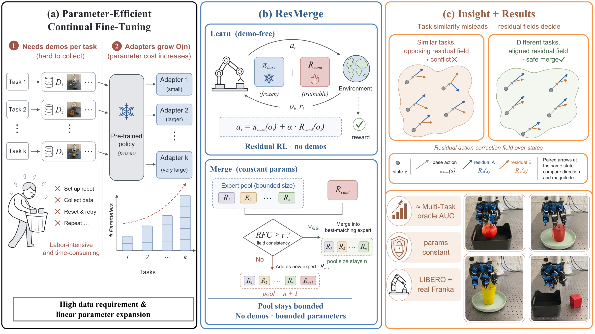

<div align="center">

<h1>🤖 ResMerge</h1>

<p><b>Residual Policy Learning and Merging for<br>Continual Adaptation of Pre-trained Robot Policies</b></p>

<a href="https://openreview.net/forum?id=wLtzr7PNBI"></a>
<a href="https://resmerge.github.io/"></a>
<a href="LICENSE"></a>

</div>

<p align="center">
  
</p>

**Learn residuals. Check compatibility. Merge robot policies.** ResMerge adapts a frozen robot policy to new tasks with lightweight residual experts. Residual-Field Consistency (RFC) compares their action corrections to guide which experts to merge and refine.

## 🚀 Quick Start

```bash
git clone https://github.com/zhucoffee/resmerge-official.git
cd resmerge-official
```

Choose your setup:

| | Base policy & platform | Get started |
|---|---|---|
| 🦾 Real robot | IMLE · Franka + LEAP hand | [Quick Start](#real-robot) · [Full guide](real_robot/README.md) |
| 🧪 Simulation | OpenVLA-OFT · LIBERO | [Quick Start](#simulation) · [Full guide](sim/README.md) |

<a id="real-robot"></a>

## 🦾 Real Robot

Learn and merge residual policies on a **Franka Panda + 16-DoF LEAP hand**. A RealSense camera provides visual observations; PICO hand tracking and a SpaceMouse support demonstration collection and human intervention.

<p align="center">
  
  <br>
  <sub>Our real-robot setup for dexterous tabletop manipulation.</sub>
</p>

### 🛠️ Install

On a Linux host with Python 3.11 and an NVIDIA GPU, run from the repository root:

```bash
cd real_robot
bash install.sh
cp hardware.example.env hardware.local.env
source .resmerge-venv/bin/activate
```

Set the robot, camera and serial-device addresses in `hardware.local.env`, then follow the [hardware setup](real_robot/HARDWARE.md) and [runtime environment activation](real_robot/README.md#2-install-the-python-environment).

### 🧠 Learn → 🔀 Merge → 📊 Evaluate

| Stage | What to do |
|---|---|
| [Collect demonstrations](real_robot/README.md#3-teleoperate-and-collect-demonstrations) | Teleoperate the arm and hand, save successful episodes, then [convert to Zarr and pretrain IMLE](real_robot/README.md#4-convert-data-and-pretrain-imle). |
| [Train residuals](real_robot/README.md#6-run-lora-residual-rl) | Keep IMLE frozen and train one LoRA residual per task with SAC and optional human intervention. |
| [Compute RFC and merge](real_robot/README.md#8-analyze-whether-task-residuals-are-compatible) | Compare task experts on shared feature states, then merge compatible actors. |
| [Evaluate](real_robot/README.md#10-evaluate-the-merged-policy-on-every-task) | Evaluate the frozen base, individual residuals and merged actors on each task. |

The supplied `pick_place` environment is the starting point for your own task configurations. Actor and learner launchers use residual scale **α = 0.05**; keep the shared base policy and observation/action conventions consistent across tasks.

**[Follow the complete real-robot tutorial →](real_robot/README.md)**

<a id="simulation"></a>

## 🧪 Simulation

Train and merge **OpenVLA-OFT** residual experts on **LIBERO** with RGB observations and proprioception.

| Suite | Released task IDs, in arrival order |
|---|---|
| Object | **1, 6, 7, 8, 9** |
| Spatial | **0, 2, 3, 6, 7** |

### 🛠️ Install & Train

Use Linux with NVIDIA GPUs, Docker and the NVIDIA Container Toolkit. Follow the [simulation installation](sim/README.md#installation) to activate the OpenVLA-OFT environment and download both suite-specific base checkpoints and the RGB encoder. Then run from the repository root:

```bash
bash examples/embodiment/run_embodiment.sh \
  libero_object_task6_lora_residual_sac_openvlaoft_rgb

bash examples/embodiment/run_embodiment.sh \
  libero_spatial_task6_lora_residual_sac_openvlaoft_rgb
```

The RGB configs train for 1,000 steps. The [full guide](sim/README.md#train) includes commands for all ten task experts and the checkpoint locations.

### 🔀 RFC, Merge & Evaluate

| Stage | Next step |
|---|---|
| [Compute RFC](sim/README.md#rfc) | Compare RGB residual checkpoints using 2,000 frozen-base rollout states per task. |
| [Merge](sim/README.md#merge) | Merge compatible experts incrementally using the selected RFC threshold. |
| [Refine](sim/README.md#refine) | Continue residual RL on the merged expert's tasks. |
| [Evaluate](sim/README.md#evaluate) | Evaluate individual, merged and refined policies on the released task subsets. |

This simulation release covers OpenVLA-OFT residual experiments. Small-model experiments and sequential OpenVLA-OFT SFT baseline training are not included.

**[Follow the complete simulation tutorial →](sim/README.md)**

---

🙏 Built on [RLinf](https://github.com/RLinf/RLinf), [OpenVLA-OFT](https://github.com/moojink/openvla-oft), [LIBERO](https://github.com/Lifelong-Robot-Learning/LIBERO), and [ConRFT](https://github.com/cccedric/conrft).

ResMerge code uses [Apache 2.0](LICENSE). Bundled third-party components retain their [respective licenses](real_robot/THIRD_PARTY.md), including CC BY-NC 4.0 for the LEAP Hand API.
